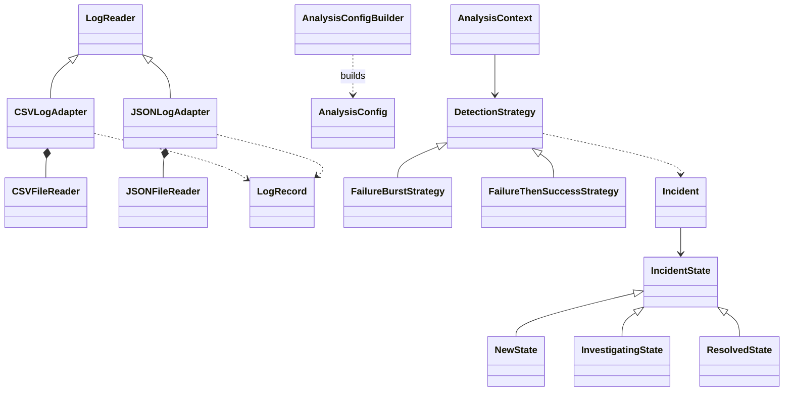
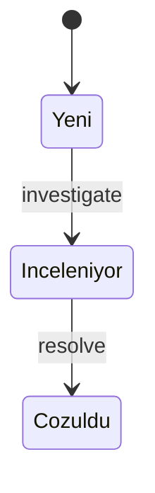

# Kalıp haritası ve UML
| Kalıp | Roller | Alternatif | Bedel / kazanım |
|---|---|---|---|
| Adapter | LogReader (Target), CSV/JSONFileReader (Adaptee), CSV/JSONLogAdapter (Adapter), LogRecord | İstemcide koşullu ayrıştırma | Ek sınıflar / ortak arayüz |
| Builder | AnalysisConfigBuilder, AnalysisConfig (Product) | Çok parametreli kurucu | Ek sınıf / merkezi doğrulama |
| Strategy | DetectionStrategy, FailureBurstStrategy, FailureThenSuccessStrategy, AnalysisContext | Tek koşullu analiz işlevi | Algoritma başına sınıf / değiştirilebilirlik |
| State | IncidentState, NewState, InvestigatingState, ResolvedState, Incident | Durum sabiti ve koşullar | Durum başına sınıf / geçiş kontrolü |

Varsayılan eşik 3 başarısız giriş, pencere 300 saniyedir. Burst IP bazında, failure-then-success IP ve kullanıcı bazında çalışır. Pencere sınırı dahildir. Burst stratejisi eşik sayısına ulaşıldığında olay üretir; sürekli yoğunlukta her kayıt için yeni olay üretmez. İki strateji aynı giriş dizisini ayrı olaylar olarak işaretleyebilir. Zaman aralığı ve IP filtreleri analiz öncesi uygulanır.
